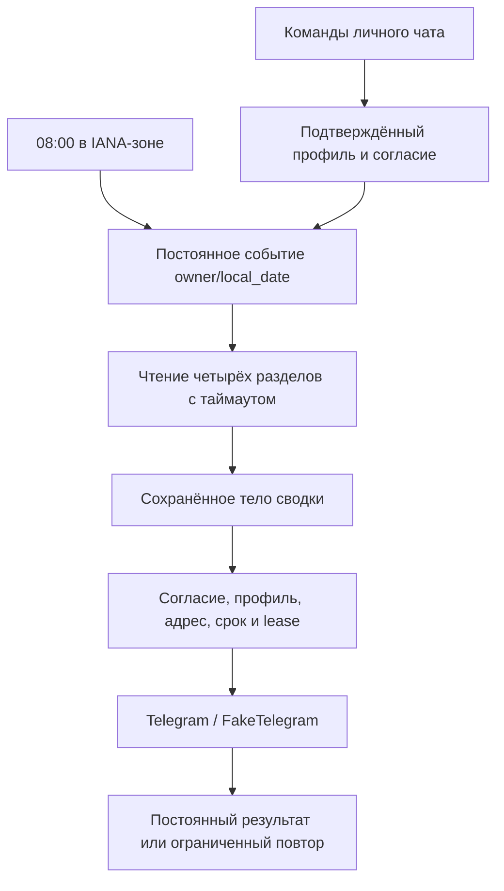

# Настройки города и ежедневная сводка: приёмка этапа

Дата: 23.11.2026. Это проверка этапа сводки, не завершение всей лабораторной 3.

## Результат и границы

Добавлены /city, /briefing_on, /briefing_off, /notifications. Город показывается
со страной и регионом; координаты записываются только по действующему подтверждению
владельца. До согласия варианты живут в RAM. Право подтверждения — пять минут;
истёкшие данные удаляются при обращении и периодической очисткой каждые 15 секунд.
После рестарта неподтверждённую карточку нужно запросить заново. Подтверждённые
город и согласие переживают перезапуск в PostgreSQL.

Выбор города не меняет timezone и не включает сводку. /briefing_on требует оба
проверенных значения; /briefing_off отзывает согласие. Смена города также выключает
сводку до отдельного нового согласия. Повтор уже использованного nonce не изменяет
профиль и не отменяет более поздний /briefing_on.

Сводка готовится с 08:00 локальной календарной даты в пределах 60 минут включительно.
Четыре источника читаются параллельно, по пять секунд на раздел. LLM в этом пути
не участвует. Фиксированные чтения через репозитории и соответствующие компоненты
разрешены методичкой. Нет инструментов изменения расписания/напоминаний и истории
диалога. Ошибка источника не скрывается под отсутствием данных.

## Ответственности

| Компонент | Ответственность и состояние |
|---|---|
| CitySelection | Временные предложения, token/owner/chat, TTL и очистка RAM |
| NotificationStore | Подтверждённый город, отдельный адрес, согласие, версия профиля, анти-replay nonce |
| BriefingSources | Только чтение: занятия владельца, напоминания его локального дня, погода координат, локальные материалы |
| BriefingStore | Постоянный event_id и UNIQUE(owner,local_date), тело, попытки, lease, результат доставки |
| BriefingService | Время/таймауты, параллельные чтения, сборка и повторная проверка перед отправкой |
| Sender | Telegram-транспорт; в тестах FakeTelegram, без обращения к сети |

Композиция отделяет получение данных от транспорта и состояния очереди. Альтернатива
с одним универсальным LLM-агентом в фоне усложнила бы проверку полномочий и могла бы
наследовать случайную историю. Здесь план фонового действия задаёт код приложения.
Цена выбранного решения — отдельная схема исходящих сводок и её приёмка; крупный
рефакторинг уже проверенной доставки напоминаний не выполнялся.



Учебный фокус выбирается ротацией доступных документов по локальной дате,
затем выполняется поиск по названию и добавляется фактическая ссылка. Для девяти
локальных документов отдельный кэш не нужен: данные малы и изменения корпуса
видны сразу. Готовое тело сохраняется и используется повторно при сбое Telegram,
поэтому источники не вызываются повторно после подготовки/перезапуска.

## Требование → реализация → доказательство

| ID spec.md | Реализация | Проверка и результат |
|---|---|---|
| B1/B2 | notifications.py, weather.find_cities, handlers/notifications.py | Нет записи координат до согласия; чужой token/TTL/replay блокируются; fresh clock после DB-lock; длинные названия не теряют кнопку и укладываются в Telegram — PASS |
| B3 | NotificationStore.set_enabled/get, команды | Без города/зоны включение отклоняется; статус не содержит IDs/координат; отдельное согласие и отказ — PASS |
| B4 | BriefingStore.reserve/claim | Два последовательных и два конкурентных reserve свежего события; два исполнителя дают одну отправку; 60 минут включительно, за границей/до08 нет запуска; локальная дата Tokyo и DST New York — PASS |
| B5/B6 | briefing_sources.py, BriefingService.body | Каталог/поиск настоящего корпуса; дата и owner в реальных репозиториях; confirmed coordinates без геокодирования; пустота/ошибка/таймаут различаются; длинные разделы помечаются — PASS |
| B7 | valid + свежая проверка часов | Отзыв согласия во время подготовки, другой адрес и истечение lease/deadline не вызывают FakeTelegram — PASS |
| B8 | PostgreSQL jobs, сохранённое тело | Временная/постоянная ошибка, максимум3 попытки, новое соединение после незавершённого sending и восстановление без повторного чтения источников — PASS |
| B9 | Связка app/__main__.py, BriefingSources | Только фиксированные методы чтения; отдельное пользовательское согласие, нет LLM/истории/записывающих MCP-инструментов — проверено ревью и тестами |

## Свежие прогоны

Полный регрессионный прогон в WSL, без записи pytest-кэша и bytecode:

```bash
PYTHONDONTWRITEBYTECODE=1 .venv/bin/python -B -m pytest -p no:cacheprovider -q
```

**639 passed, 10 skipped, 50.19 секунды.** Пропуски — отдельно включаемые
PostgreSQL/Docker-тесты. Это свежий результат после последнего изменения длинных
названий города. `.venv/bin/python -B -m pip check`: `No broken requirements found`.
Ruff check/format и git diff --check: PASS.

PostgreSQL-проверка нового этапа:

```bash
RUN_INTEGRATION=1 .venv/bin/python -B -m pytest -p no:cacheprovider -q tests/test_briefing_integration.py
```

**2 passed, 23.92 секунды.** Первый тест объединяет сценарии настроек, постоянной
очереди и доставки; второй проверяет реальное чтение расписания/напоминаний разных
владельцев, локальный корпус и погодный адаптер с подменённым внешним источником.
Фикстура создаёт собственные временные Docker-контейнеры/тома и очищает только их.

Ранее целевой прогон дал 120 passed, 1 deselected: один тест конфигурации тогда был
исключён из прогона без артефактов; в итоговом полном прогоне он включён. Ограничение
среды разрешено безопасной альтернативой: -B, no cacheprovider и наследование
отключения bytecode дочерним MCP-процессом. Рабочий запуск без -B не меняется.

## Ревью, применение и оставшееся

Независимое read-only ревью нашло и помогло исправить проверку TTL до ожидания БД,
молчаливое усечение напоминаний и неточное описание срока хранения RAM. После
исправлений в просмотренном этапе блокирующих ошибок не найдено. Результат
подтверждён основным агентом указанными тестами, а не только отчётом ревьюера.

Рабочая БД не использовалась, .env не менялся, бот не перезапускался, второй polling
не запускался. Реальные сообщения не отправлялись. После одного ручного перезапуска
можно выполнить /city → подтверждение → /briefing_on → /notifications.

Сводка независима от флага автодоставки напоминаний: командное согласие управляет
только сводкой. Если включить её после09:00, запуск пропускается до следующего дня;
внутри окна возможна немедленная подготовка. /briefing_off блокирует ещё не
отправленные задания. Сбой после фактической отправки до записи sent всё ещё
может привести к дублю; exactly-once не обещается.

Не завершены всей ЛР3: PostgreSQL-трассировка и /trace, provider token usage,
эксперимент15 запросов, полная таблица шести проверок безопасности и итоговый отчёт.
